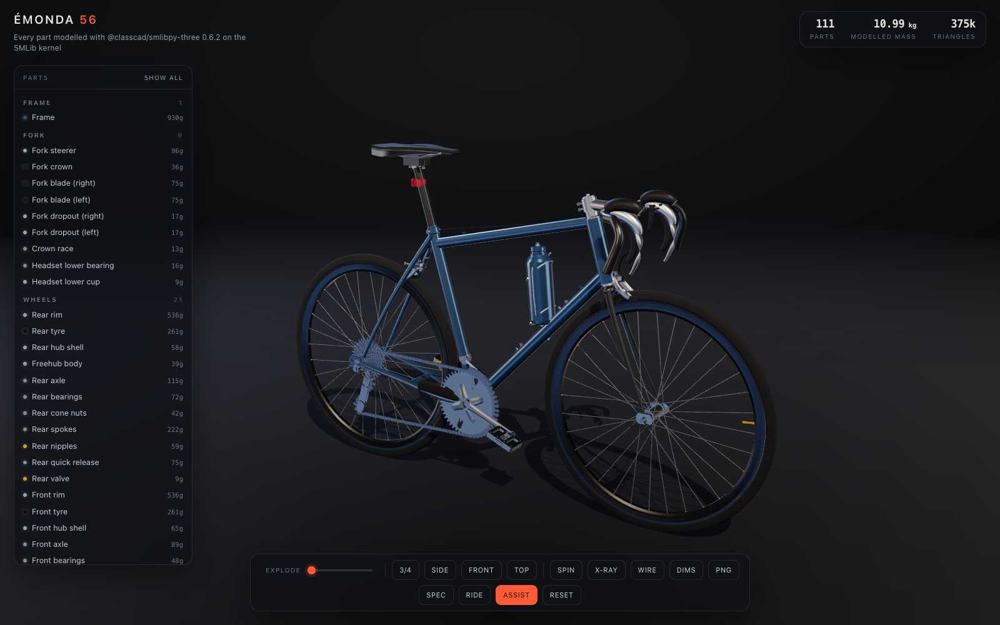
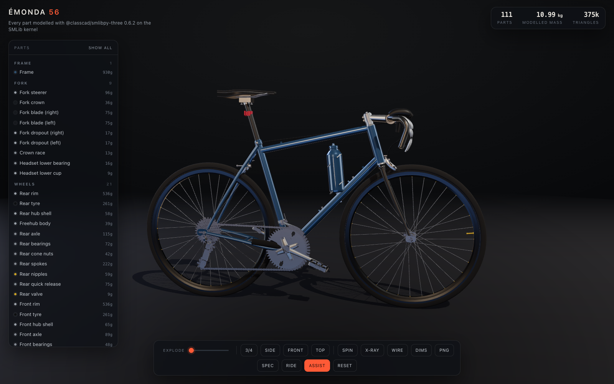
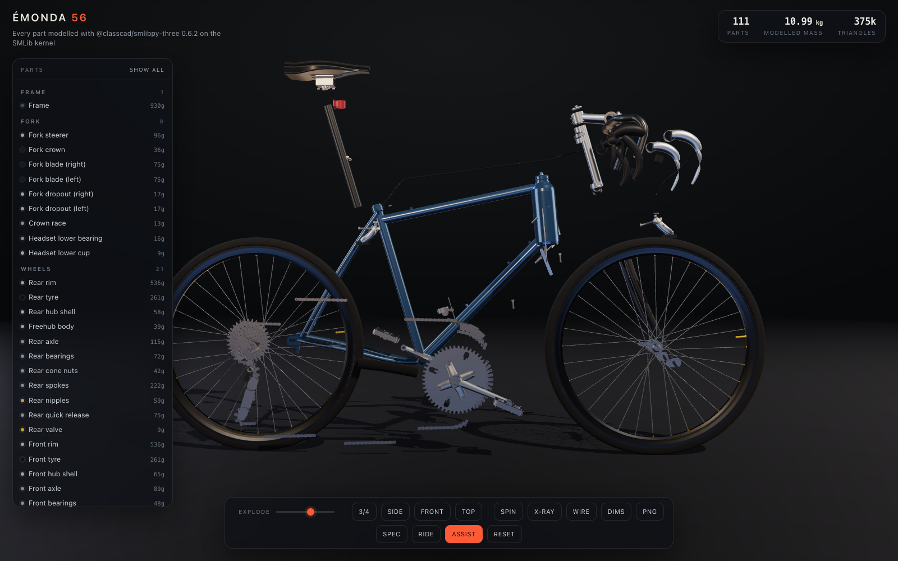
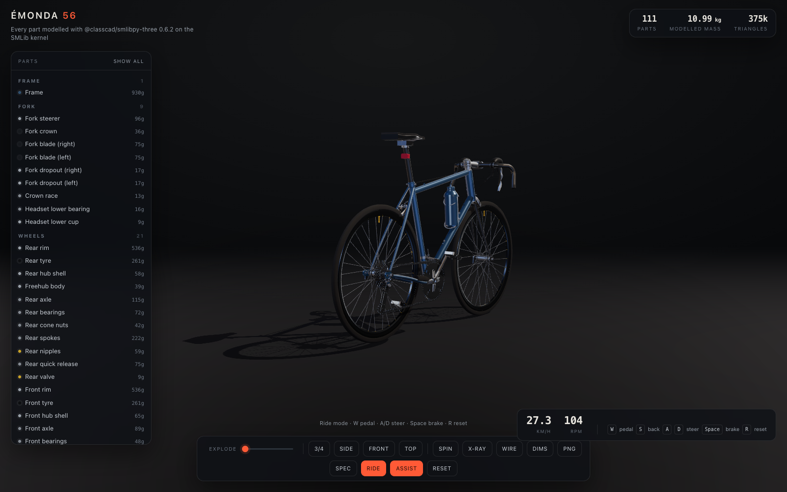
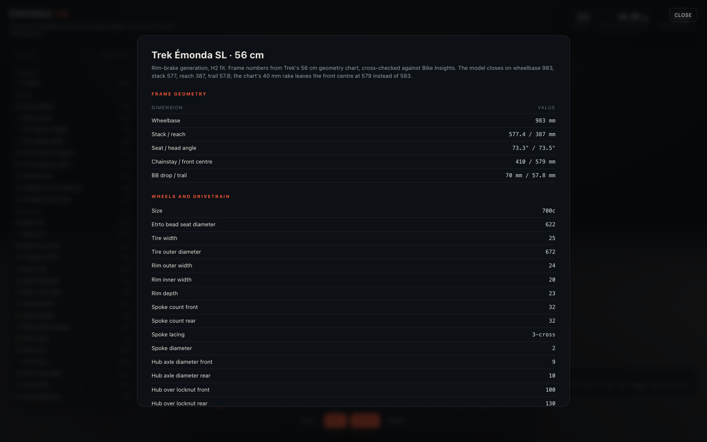

# Émonda 56

**A bicycle, every part, as one HTML page.** 111 parts modelled from a real 56 cm road bike's
geometry with [@classcad/smlibpy-three](https://www.npmjs.com/package/@classcad/smlibpy-three) on
the SMLib kernel, packed with three.js and Rapier into a single file that opens offline.

## See it

Everything is published to GitHub Pages. No server, no build step, just open the link:

|                               |                                                          |
| ----------------------------- | -------------------------------------------------------- |
| **The model**                 | <https://jimlah.github.io/bicycle/>                      |
| The generator, in this repo   | [`build/`](./build)                                      |
| Every dimension, with its URL | [`build/specs.json`](./build/specs.json)                 |
| The part list and the masses  | the left rail in the page                                |



## What this is

- **A real bike, not a shape.** Wheelbase 983, stack 577, reach 387, 73.3 and 73.5 degree angles,
  410 mm chainstay, 40 mm rake, 57.8 mm trail, from a Trek Émonda SL rim-brake frameset. The
  components are a Shimano 105 R7000 group, a DT Swiss PR 1600 class rim and 25-622 tyres, so the
  chainring teeth and the chain's pitch radius agree by construction.
- **One file, offline.** The geometry is 5.2 MB quantised to 16 bit positions and 8 bit normals,
  gzipped, and inlined with three.js and Rapier. Opening the page makes zero network requests.
- **It rides.** The bike is one rigid body with a convex hull collider per part and the mass its
  own B-rep volume gives it. Pedal and it accelerates, brake and it stops, steer and the front end
  turns about the head tube, turn the assist off and it falls over and lands on its colliders.

|                                         |
| --------------------------------------- |
|          |
|  |
|        |
|  |

## What is in it

111 parts, 374,916 triangles, 10.99 kg modelled mass.

| assembly   | parts | what                                                                                                                                                       |
| ---------- | ----- | ---------------------------------------------------------------------------------------------------------------------------------------------------------- |
| Frame      | 1     | welded steel body, hollow butted tubes, BB shell, dropouts, stays, bridges, bottle bosses, cable stops, mech hanger, collar                                  |
| Fork       | 9     | steerer, crown, two raked blades, dropouts, crown race, lower headset cup and bearing                                                                       |
| Wheels     | 21    | hollow 25 mm rims on a 622 bead seat, 25-622 tyres, hubs, axles, bearings, 32 three-cross spokes and nipples per wheel, valves, quick releases, freehub       |
| Drivetrain | 46    | BSA 68 bottom bracket, 172.5 mm hollow cranks, 50/34 rings, chainring bolts, pedals, 11-32 cassette, 116 link chain, both derailleurs, STI levers             |
| Cockpit    | 15    | one-sweep 420 mm drop bar, 100 mm stem with faceplate, upper headset and spacers, Ø27.2 seatpost, 272 x 143 saddle over rails                                |
| Brakes     | 12    | two dual-pivot rim calipers, pads, springs, housing, inner cables, levers                                                                                    |
| Finishing  | 7     | bottle cage and bottle, seat binder, bar end plugs, reflector, chainstay protector                                                                           |

## Ride it

Press `RIDE`. Then `W` pedals, `S` back-pedals, `A` and `D` steer, `Space` brakes, `R` resets, and
`ASSIST` turns the rider's balance off so you can watch it topple.

Outside ride mode, drag to orbit, click a part to read its dimensions and mass, drag the explode
slider to pull the build apart, and `SPEC` opens the geometry sheet with the source for every
number.

## Run it locally

Open `index.html`. That is the whole thing. There is nothing to install.

## Rebuild it

`build/` is the generator. Every part is an exact B-rep and a three.js mesh at once, so a part
module runs on its own and renders a picture:

```bash
cd build
npm install
node parts/wheels.mjs     # one assembly, with a PNG and a mass table
node pack.mjs             # every part, tessellated, quantised and packed into ../index.html
node previews.mjs         # the screenshots in this README
node test-ride.mjs        # rides it in headless Chrome and prints speed, brake and steer
node live-check.mjs       # opens the published page and checks it still loads clean
```

`pack.mjs` prints the part count, the triangle count and the packed size. It takes about six
minutes, most of it the kernel tessellating 111 bodies.

## The physics, briefly

The first version put a revolute joint at every axle. A driven wheel barely turned: measured in a
synchronous 600 step run, 0.007 rad/s on the rear wheel with drive torque applied, and a jointed
wheel in isolation spun 48 times slower than a free one. The joints went. The bike is now one rigid
body carrying a collider per part, and the wheels, cranks, pedals, steering and chain are
articulated on top of it. Measured, 12.3 km/h after one second of pedalling, 28.4 km/h after five,
2.9 km/h after two seconds of braking.

## Limits

Tube joints are mitered unions without blend fillets, because the kernel refuses to round a welded
junction and a sharp seam reads as a weld at this scale. Bearing balls, thread forms, cable strands
and gear tooth involutes are simplified. Hollow and foam parts carry an effective density so the
mass readout matches the real part. The frame is drawn as welded steel although the donor bike is
carbon, and the masses follow the geometry rather than a catalogue.

## Built with

[smlibpy](https://smlibpy.classcad.ch/) (MIT, the SMLib kernel), [three.js](https://threejs.org/)
(MIT) and [Rapier](https://rapier.rs/) (Apache 2.0).
